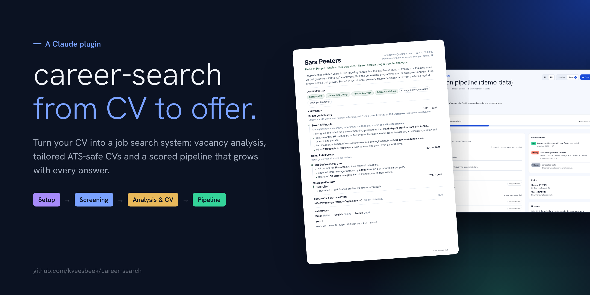
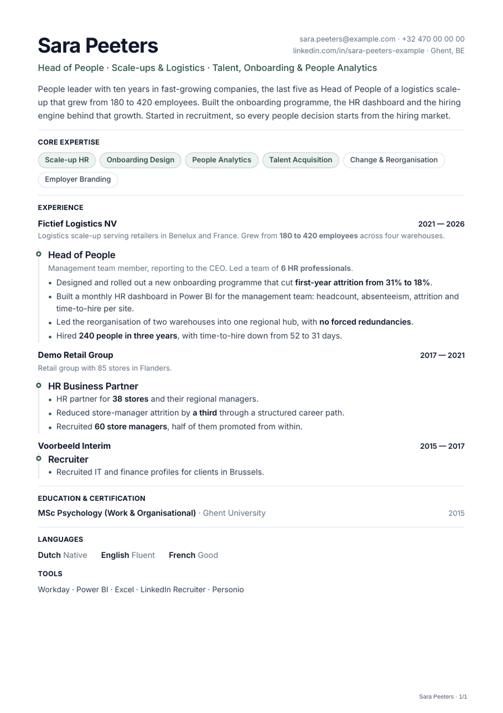
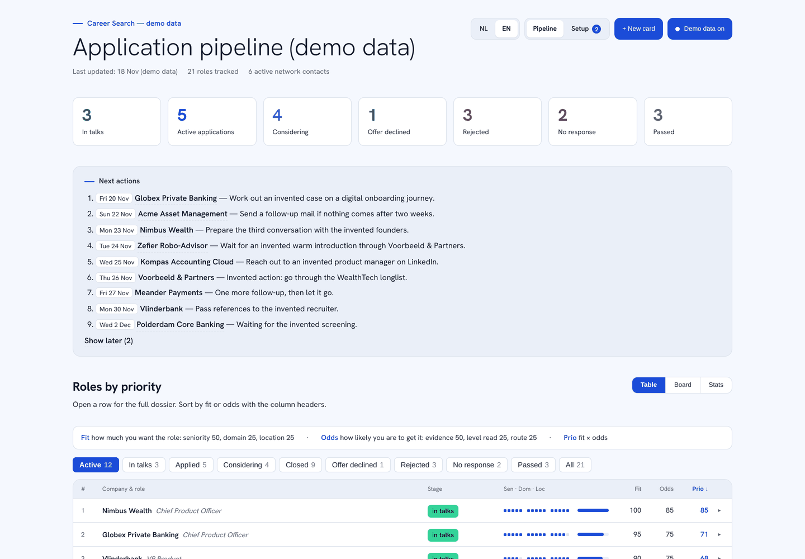
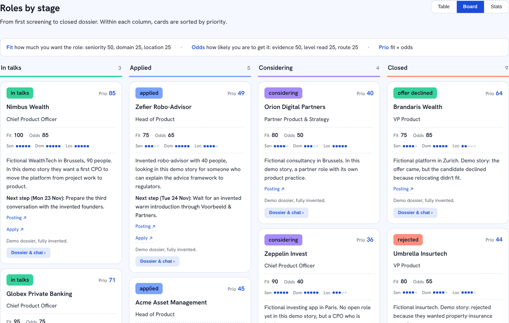
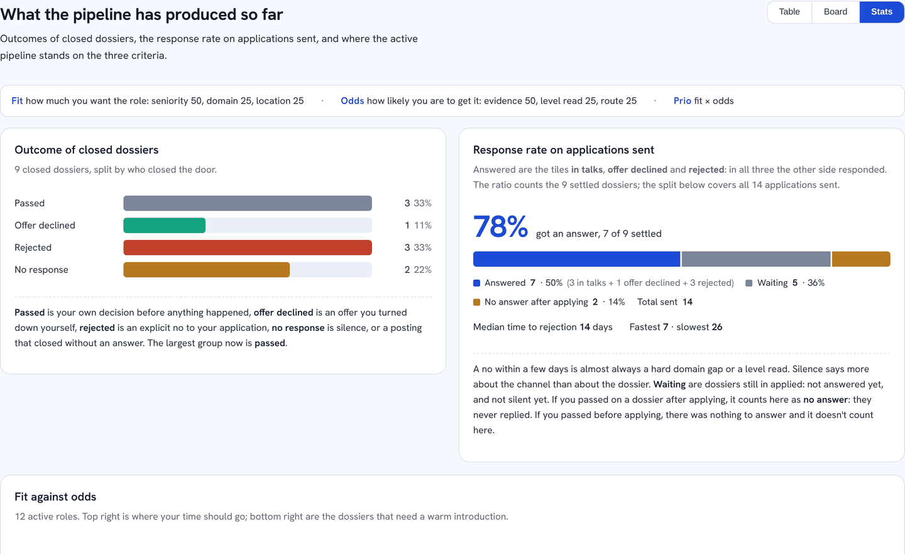
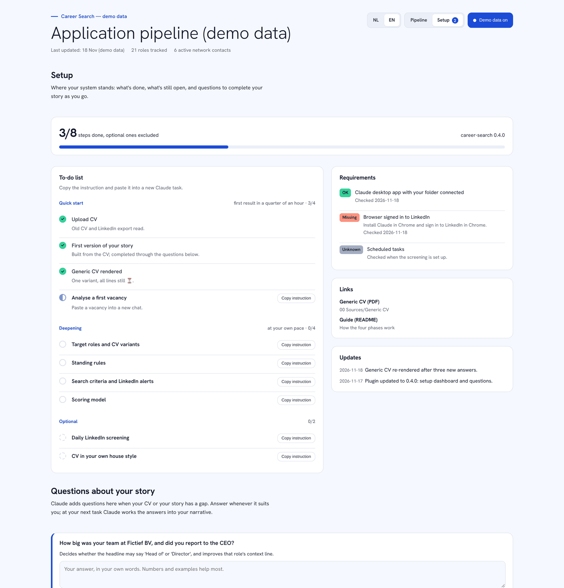
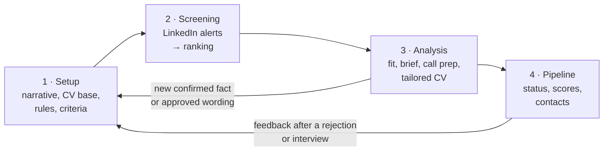

# career-search · a Claude plugin

A job search system for Claude: from your CV to tailored, ATS-safe CVs, vacancy analyses, company briefs, LinkedIn screening and a scored application pipeline.

## Install

1. In the Claude desktop app or on claude.ai, open **Customize → Plugins**.
2. Under **Personal plugins**, click **+** → **Add marketplace** → **Add from a repository**, and enter `kveesbeek/career-search`.
3. Install **career-search** from that marketplace.
4. Connect an empty folder for your career files in the Claude desktop app, upload your CV and say *"set up my career search"*.

No "Add from a repository" option? Download `career-search.plugin` from the [latest release](../../releases) (or zip `plugins/career-search`) and choose **Upload plugin** instead.

Updates arrive through the marketplace: your own files (narrative, CV base, rules) live in your folder and are never touched by an update.

## What you get

**A tailored, ATS-safe CV per vacancy.** You approve a short change list against your own CV base; Claude renders a clean two-page PDF and checks it (page count, section titles, contact details, banned phrases, keyword coverage). Sample with a fictional candidate:

**A scored pipeline.** Every role gets a Fit and a Winnability score, a next step and a dossier with its own chat. Board, ranked table and stats views. Shown here with the built-in demo data. The page has an NL / EN switch:

**A setup dashboard.** Your onboarding as a to-do list, the requirements, recent updates, and questions about your story that you answer whenever it suits you. Claude folds the answers into your career narrative.

---

A job search system for Claude, in four phases. The skills hold the method. Everything personal (your facts, your CV wording, your rules, your criteria) lives in your own folder, so the same plugin works for anyone and keeps improving without losing your setup.

## Skills

| Phase | Skill | What it does |
|---|---|---|
| 1 | `career-setup` | Builds your sources from your CV, LinkedIn export and an interview. Re-run it to add a role type, CV language or criteria. |
| 2 | `linkedin-job-screening` | Walks all your LinkedIn job alerts, scores new vacancies against your criteria, appends a dated section to your ranking file. Runs as a scheduled task. |
| 3 | `vacancy-analysis` | Candid fit assessment, scores, how to apply, interview prep. Paste a posting to start. |
| 3 | `company-brief` | One-page research brief, or prep for a call with a named person. |
| 3 | `cv-tailoring` | Proposes a change list against your approved CV base (you never re-read a full CV), renders an ATS-safe two-page PDF, validates it in a Check file. |
| 4 | `career-pipeline-tracker` | Keeps a scored kanban page of all roles and contacts up to date, in the same turn anything changes. The page itself ships with the plugin (no data, in the author's house style, with an NL / EN switch) and has its own chat per card. |

Your writing style is a separate, personal skill. If you don't have one, use `setup-writing-style` and put its name in your profile.

## Your folder

| Folder | Contents |
|---|---|
| `00 Sources/` | `profile.yaml` (settings), career narrative (facts), `cv_base.md` (approved CV lines with IDs), `standing_rules.md` (what you may and may not claim, wording per reader), `search_criteria.md`, scoring model. |
| `01 System/` | Optional: brand fonts (`fonts/`) for the CV design, or your own CV template for structural changes. |
| `02 Screening/` | LinkedIn ranking, last four weeks, plus a monthly archive. |
| `03 Companies/<Company>/` | Everything for one active process. |
| `Sent/` | Exactly what was sent. Never edited. |
| `99 Archive/` | Closed processes and old versions. |

## Where to change what

| You want to ... | Edit |
|---|---|
| Add or correct a fact | the career narrative |
| Approve a CV wording permanently | `cv_base.md` |
| Add a "never claim X" rule | `standing_rules.md` |
| Widen or narrow the search | `search_criteria.md` and the LinkedIn alerts |
| Change how roles are scored | the scoring model |
| Align the CV with your house style | `cv.design` in `profile.yaml` (import it from your design system's tokens; fonts in `01 System/fonts/`) |
| Change how a phase works | the skill, so everyone gets the improvement |

## Requirements

- Claude with skills, artifacts and scheduled tasks.
- The Claude desktop app with your career folder connected (or Google Drive via the connector, with some limits).
- For screening and LinkedIn links: Claude in Chrome (recommended: your own Chrome, where you are already signed in) or the built-in browser of the desktop app, signed in to LinkedIn. `career-setup` checks this first, and the skills stop with a clear message when the extension is missing, Chrome is closed or you are signed out.
- CV rendering runs in Claude's cloud workspace (Python, Playwright); nothing to install on your computer.

## Getting started

Upload your CV and say "set up my career search". The quick start takes about a quarter of an hour: Claude drafts your career narrative and a CV base from the CV, renders a first CV, creates your pipeline page and analyses a first vacancy with you.

Everything after that is deepening, one step at a time: CV variants, what you may and may not claim, search criteria, scoring, daily screening, your house style. The **Opzet** tab of your pipeline page shows the full list with what is done, what is open and the sentence to give Claude for each step.

The same tab holds **questions about your story**: whenever Claude sees a gap (a result without a number, a team size, a reason for a move), it adds a question there. Answer when it suits you, also from your phone; at your next task Claude puts the answers into your narrative. That is how the narrative grows without long interviews.

## License

[PolyForm Noncommercial 1.0.0](LICENSE.md): free to use, change and share for personal and other noncommercial purposes. Commercial use, such as offering it as part of a paid outplacement, recruitment or coaching service, needs the author's permission. Bundled fonts keep their own licence: see [THIRD-PARTY-NOTICES.md](THIRD-PARTY-NOTICES.md).
